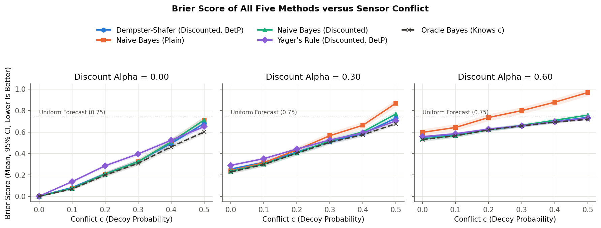

# Dempster-Shafer Sensor Fusion

Evidence fusion for classifying air contacts from multiple conflicting sensors. A tactical control system receives radar, imaging, and electronic support measures (ESM) reports that are noisy, often coarse, and sometimes deliberately misleading. Operators and track management logic act on the confidence attached to the fused class, so that confidence needs to be well calibrated, not just accurate.

This project asks whether Dempster-Shafer evidence fusion preserves accuracy and calibration better than naive Bayesian fusion in that setting.

## Approach

Dempster-Shafer fusion, naive Bayesian fusion, Yager's combination rule, and an oracle Bayesian posterior that knows the true generative model are implemented from first principles as a tested Python package. All four run on identical simulated evidence across 36 sensor reliability and conflict conditions, with 2,000 contacts per condition and five independent seeds, and are scored on accuracy and Brier score calibration.

## Findings

- Accuracy never separates the methods. Even the oracle is at most 0.016 more accurate, so the evidence limits accuracy rather than the combination rule.
- Calibration does separate them. Dempster-Shafer improves the Brier score over plain naive Bayes by up to 0.29, but about nine tenths of that gain comes from reliability discounting.
- Once both rules are discounted, the methods form a ladder of increasing caution. The best calibrated choice depends on how much conflict the sensor model fails to anticipate. A discounted Bayesian rule is best when unmodeled conflict is rare, Dempster's rule at moderate conflict, and Yager's rule at the highest conflict.
- The crossover reproduces under every seed, with no reversal of sign in any condition.



## Paper and slides

- [Case study paper (PDF)](paper/Lane-DS-Fusion-Case-Study-Paper.pdf)
- [Presentation slides (PDF)](slides/Lane-DS-Fusion-Presentation.pdf)

## Repository contents

| Path | Role |
|---|---|
| `dsfusion/core.py` | Frame of discernment as bitmasks, mass functions, Shafer discounting, Dempster's rule with conflict tracking, belief, plausibility, pignistic transform |
| `dsfusion/bayes.py` | Naive Bayes baseline, plain and with likelihoods tempered by the same discount |
| `dsfusion/extensions.py` | Yager's rule, the oracle Bayesian posterior, the five method grid, and the seed schedule |
| `dsfusion/simulator.py` | Radar, imaging, and ESM sensors over fighter, transport, helicopter, and UAV classes with known ground truth |
| `dsfusion/experiment.py` | Metrics, the reliability and conflict grid, and the misspecified discount study |
| `dsfusion/validation.py` | Hand derived expected values paired with observed outputs |
| `tests/` | Unit tests for the fusion rules and extensions |
| `run_experiment.py` | Worked trace of one contact, the main 6 by 6 grid, and the misspecification study |
| `run_extensions.py` | Five method grid and five seed replication |
| `run_timing.py` | Runtime against frame size |
| `DS_Fusion_Walkthrough.ipynb` | Step by step walkthrough of the method and results |
| `results/` | CSV summaries, figures, and run logs from the runs reported in the paper |

## Running it

Python 3.9 or later. No evidence theory library is used.

```
pip install -r requirements.txt
python -m unittest -v            # validation tests, under one second
python run_experiment.py         # main grid and misspecification study, about 10 seconds
python run_extensions.py         # Yager, oracle, and seed replication, under one minute
python run_timing.py             # runtime study, about one minute
jupyter notebook DS_Fusion_Walkthrough.ipynb
```

All randomness flows from the fixed seed `605745`, and each grid cell draws from its own stream, so rerunning the scripts reproduces the CSV files exactly.

## Built with

Python, NumPy, pandas, Matplotlib

## Context

Research project for EN.605.745 Reasoning Under Uncertainty at Johns Hopkins University (Fall 2026).
